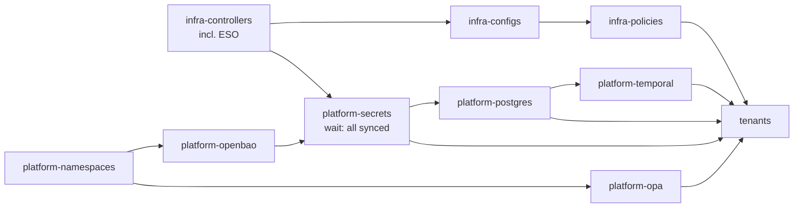

# dashr-platform-gitops

Cluster definition for the DASHR platform, reconciled by Flux. This repo owns
the cluster, its shared services, and the answer to "where does everything
live". Applications live in their own repos and are plugged in as **tenants**.

```
clusters/<env>/            Flux entry point per cluster (flux bootstrap --path)
  cluster-vars.yaml        where things live in this cluster (${var} substitution)
  infrastructure.yaml      infra-controllers -> infra-configs -> infra-policies
  platform.yaml            namespaces, OpenBao, OPA, secrets gate, postgres, temporal
  tenants.yaml             application tenants, after the platform is ready
infrastructure/
  controllers/             Istio, CloudNativePG, Gatekeeper, External Secrets, SeaweedFS
  configs/                 Istio gateway, Gatekeeper constraint templates
  policies/                Gatekeeper constraints for tenant namespaces
platform/
  namespaces/              shared namespaces and their labels
  openbao/                 in-cluster OpenBao (local clusters only)
  openbao-reviewer/        lets an external OpenBao trust this cluster (production)
  secrets/                 SecretStores + ExternalSecrets: the secrets gate
  postgres/                shared CNPG cluster, roles, databases, pooler, network policy
  temporal/                Temporal on the shared Postgres
  opa/                     OPA server for application authorization decisions
  harbor/                  prepared, not enabled yet
tenants/dashr-nova/        deploy service account, platform values, Git source, Flux sync
scripts/                   configure-openbao.sh, seed-secrets.sh, unseal.sh
```

## How the pieces fit

| Concern | Lives in | Notes |
|---|---|---|
| Where a service is (hosts, ports, URLs) | `clusters/<env>/cluster-vars.yaml` | Substituted into manifests by Flux |
| Credentials | OpenBao, `kv/<component>/db` | Never in Git |
| Getting credentials into the cluster | `platform/secrets/` | ESO, one SecretStore and OpenBao role per namespace |
| What an app is given | `tenants/<app>/platform-values.yaml` | Read by the app's HelmRelease via `valuesFrom` |
| What runs in each environment | the app's deploy repo | Image and chart tags, by commit |

Because consumers only ever see Secret **names** and values supplied by the
platform, moving Postgres, Temporal, OPA or OpenBao is a change to
`cluster-vars.yaml` (and OpenBao itself), never to an application repo.

## Reconciliation order and the secrets gate



`platform-secrets` is only Ready when every ExternalSecret has synced from
OpenBao. Until OpenBao is unsealed and seeded it keeps retrying, and Postgres,
Temporal and the tenants wait instead of failing. This avoids Helm releases
exhausting their retries and jobs failing for missing credentials.

## Bootstrap a local cluster

**Phase A: automated.** Bootstrap Flux without the image automation
controllers (deployments are promoted by Git commits, not registry watching):

```bash
flux bootstrap github \
  --owner=YOUR_ORG --repository=dashr-platform-gitops \
  --branch=main --path=clusters/local \
  --components=source-controller,kustomize-controller,helm-controller,notification-controller
```

Controllers, namespaces, OPA and OpenBao come up. `openbao-0` shows `0/1` ready
because it is sealed. `platform-secrets` and everything after it wait.

**Phase B: once, by hand.** Initialise, unseal, configure and seed OpenBao:

```bash
kubectl exec -n openbao -ti openbao-0 -- bao operator init -key-shares=1 -key-threshold=1
#   Save the unseal key and root token in a password manager. Never in Git.
./scripts/unseal.sh

kubectl port-forward -n openbao svc/openbao 8200:8200 &
export BAO_ADDR=http://127.0.0.1:8200
bao login                         # root token, first time only

./scripts/configure-openbao.sh    # engines, auth, policies, roles
./scripts/seed-secrets.sh         # generates any missing credentials
```

**Phase C: automated.** Within a minute the gate opens and Postgres, Temporal
and the tenants deploy. Watch with `flux get kustomizations -w`.

**Afterwards:** create a personal admin login (userpass or OIDC with an admin
policy) and revoke the root token with `bao token revoke <token>`. If you need
root again, use `bao operator generate-root` with the unseal key.

**After any restart** of the OpenBao pod or its node, run `./scripts/unseal.sh`.
Syncs pause while it is sealed; existing Kubernetes Secrets keep working.

**Backups:** `bao operator raft snapshot save openbao-$(date +%F).snap`
(`*.snap` is git-ignored). Test a restore at least once.

## Production

OpenBao runs **outside** the cluster (dedicated VMs with integrated Raft, a
management cluster, or an institutional service), with TLS and auto-unseal.
The production cluster:

- does not include `platform/openbao`; it includes `platform/openbao-reviewer`,
  which gives the external OpenBao a token to validate this cluster's service
  accounts;
- uses its own auth mount (`openbao_auth_mount: kubernetes-production`), so one
  OpenBao can serve several clusters;
- needs only one manual step, once per cluster:

```bash
export BAO_ADDR=https://openbao.example.internal:8200 && bao login
MODE=external AUTH_MOUNT=kubernetes-production \
K8S_HOST=https://<api-server>:6443 ./scripts/configure-openbao.sh
```

Credentials already exist in OpenBao, so rebuilding the cluster needs no
seeding: Flux comes up, ESO authenticates, the gate opens, everything deploys.

## Shared PostgreSQL pattern

One CloudNativePG cluster (`platform-pg` in `database`) serves every
component, with one login role and one database per component.

| Component  | Role         | Database(s)                        | OpenBao entry     | Connects via            |
|------------|--------------|------------------------------------|-------------------|-------------------------|
| dashr-nova | `dashr_nova` | `dashr_nova`                       | `kv/dashr-nova/db`| `platform-pg-pooler-rw` |
| Temporal   | `temporal`   | `temporal`, `temporal_visibility`  | `kv/temporal/db`  | `platform-pg-rw`        |
| Harbor     | `harbor`     | `registry` (ready for later)       | `kv/harbor/db`    | `platform-pg-rw`        |

Each credential exists once in OpenBao. ESO projects it twice: into the
`database` namespace for CNPG, and into the component's namespace in the shape
the component expects. The platform provisions roles and empty databases; each
component owns its schema (Temporal's schema jobs, dashr-nova's migrations).

**Adding a component that needs Postgres**

1. Add a role in `platform/postgres/cluster.yaml` and a `Database` in
   `platform/postgres/databases.yaml`.
2. Label its namespace `platform.dashr/postgres-client: "true"`.
3. Add `seed_db <component> <user>` to `scripts/seed-secrets.sh`, and the
   component to the loop in `scripts/configure-openbao.sh`. Re-run both.
4. In `platform/secrets/`: a `pg-role-<component>` ExternalSecret in
   `database`, plus a SecretStore, service account and ExternalSecret in the
   component's namespace.

**When to give a component its own Postgres cluster:** when its load affects
others (Temporal is the usual first candidate), when it needs a different
version or upgrade window, or different backup and retention. Same pattern,
second `Cluster`.

**Backups:** configure CNPG WAL archiving and base backups to a SeaweedFS S3
bucket (Barman Cloud plugin on newer CNPG, `barmanObjectStore` on older).
Test a restore before production.

## Adding a tenant application

1. Add its namespace to `platform/namespaces/namespaces.yaml` with
   `platform.dashr/tenant: "true"` (and `postgres-client` if needed).
2. Copy `tenants/dashr-nova/` to `tenants/<app>/`; change names, the Git URL
   and `platform-values.yaml` to answer the new chart's dependency contract.
3. Add its credentials (see above) and add it to `tenants/kustomization.yaml`.

## Pinning versions

Chart versions are `"*"` (and the OPA image tag is a placeholder) so the model
reconciles out of the box. Before relying on it, pin each to a version you
have tested, keep the three Istio charts on the same version, and check value
names (Temporal, OpenBao, SeaweedFS) against the chart version you pin.

## Notes

- Gatekeeper constraints only apply to tenant namespaces: images must come
  from `${image_registry}/` (plus the Istio sidecar) and must not be `:latest`
  or untagged. Locally they `warn`; in production they `deny`.
- `database`, `temporal`, `policy` and `openbao` are outside the mesh. Access
  to Postgres and OpenBao is restricted by NetworkPolicies, which only take
  effect if your CNI enforces them.
- Kubernetes Secrets still exist in etcd once synced: enable encryption at rest
  and keep `get secrets` RBAC narrow.
