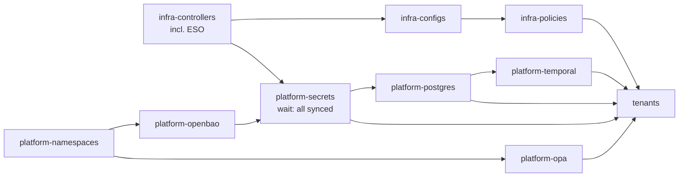

# dashr-platform-gitops

Cluster definition for the DASHR platform, reconciled by Flux. This repo owns
the cluster, its shared services, and the answer to "where does everything
live". Applications live in their own repos and are plugged in as **tenants**.

```
clusters/<env>/            Flux entry point per cluster (flux bootstrap --path)
  cluster-vars.yaml        where things live in this cluster (${var} substitution)
  infrastructure.yaml      infra-controllers -> infra-configs -> infra-policies
  platform.yaml            namespaces, OpenBao (local), OPA, secrets gate, postgres, temporal
  tenants.yaml             application tenants, after the platform is ready
infrastructure/
  controllers/             Istio, CloudNativePG, Gatekeeper, External Secrets, SeaweedFS
  configs/                 Istio gateway, Gatekeeper constraint templates
  policies/                Gatekeeper constraints for tenant namespaces
platform/
  namespaces/              shared namespaces and their labels
  openbao/                 in-cluster OpenBao (local clusters only)
  secrets/                 the secrets gate:
    base/                  ExternalSecrets (provider-neutral, store "platform")
    stores/openbao/        SecretStores for OpenBao (local)
    stores/aws/            SecretStores for AWS Secrets Manager via IRSA (production)
    openbao/, aws/         what a cluster points its platform-secrets path at
  postgres/                shared CNPG cluster, roles, databases, pooler, network policy
  temporal/                Temporal on the shared Postgres
  opa/                     OPA server for application authorization decisions
  harbor/                  prepared, not enabled yet
tenants/dashr-nova/        deploy service account, platform values, Git source, Flux sync
scripts/                   configure-openbao.sh, seed-secrets.sh, unseal.sh (local)
                           seed-secrets-aws.sh (production)
```

## How the pieces fit

| Concern | Lives in | Notes |
|---|---|---|
| Where a service is (hosts, ports, URLs) | `clusters/<env>/cluster-vars.yaml` | Substituted into manifests by Flux |
| Credentials | `<component>/db`: OpenBao locally (`kv/` mount), AWS Secrets Manager in production | Never in Git |
| Getting credentials into the cluster | `platform/secrets/` | ESO, one SecretStore per namespace, each with its own OpenBao role or IAM role |
| What an app is given | `tenants/<app>/platform-values.yaml` | Read by the app's HelmRelease via `valuesFrom` |
| What runs in each environment | the app's deploy repo | Image and chart tags, by commit |

Because consumers only ever see Secret **names** and values supplied by the
platform, moving Postgres, Temporal, OPA or OpenBao is a change to
`cluster-vars.yaml` (and the service itself), never to an application repo.
Switching the secrets backend is a change to the cluster's `platform-secrets`
path (`./platform/secrets/openbao` or `./platform/secrets/aws`).

## Reconciliation order and the secrets gate



`platform-secrets` is only Ready when every ExternalSecret has synced from
the secrets backend. Until OpenBao is unsealed and seeded (locally), or the
IAM roles and secrets exist in AWS (production), it keeps retrying, and Postgres,
Temporal and the tenants wait instead of failing. This avoids Helm releases
exhausting their retries and jobs failing for missing credentials.

## Bootstrap a local cluster

**Phase A: automated.** Bootstrap Flux without the image automation
controllers (deployments are promoted by Git commits, not registry watching):

```bash
flux bootstrap github \
  --owner=YOUR_ORG --repository=dashr-platform-gitops \
  --branch=main --path=clusters/local \
  --components=source-controller,kustomize-controller,helm-controller,notification-controller
```

Controllers, namespaces, OPA and OpenBao come up. `openbao-0` shows `0/1` ready
because it is sealed. `platform-secrets` and everything after it wait.

Bootstrap tips:

- **Re-running bootstrap is safe** with the same flags and the same or a newer
  `flux` CLI: unchanged manifests produce no commit, and a newer CLI upgrades
  the controllers. Customise `flux-system/kustomization.yaml` (patches); the
  generated `gotk-*.yaml` files are overwritten on every run.
- Without `--token-auth`, bootstrap uses **SSH** and creates a read-only deploy
  key. It reuses an existing `flux-system/flux-system` Secret, so if an earlier
  run used a token you get `invalid 'ssh' auth option: 'identity' is required`:
  delete that Secret and bootstrap again (or add `--token-auth`).
- `sync path configuration would overwrite path ... of existing Kustomization`
  means the cluster was bootstrapped from another repo or path. Bootstrap will
  not silently repoint it; remove the old sync objects first (see
  Troubleshooting).
- To start over, use `flux uninstall`. Deleting the `flux-system` namespace
  leaves it stuck in `Terminating` on Flux finalizers.

**Phase B: once, by hand.** Initialise, unseal, configure and seed OpenBao.
Install the CLI first (`brew install openbao`). Run `init` in your own
terminal, not in a shared or recorded session: it prints the unseal key and
root token.

```bash
kubectl exec -n openbao -ti openbao-0 -- bao operator init -key-shares=1 -key-threshold=1
#   Save the unseal key and root token in a password manager. Never in Git.
./scripts/unseal.sh
kubectl exec -n openbao openbao-0 -- bao status   # "Sealed false" means unsealed

kubectl port-forward -n openbao svc/openbao 8200:8200   # in a second terminal
export BAO_ADDR=http://127.0.0.1:8200
bao login                         # root token, first time only

./scripts/configure-openbao.sh    # engines, auth, policies, roles
./scripts/seed-secrets.sh         # generates any missing credentials
```

**Phase C: automated.** Within a minute the gate opens and Postgres, Temporal
and the tenants deploy. Watch with `flux get kustomizations -w`.

ExternalSecrets that failed while OpenBao was sealed back off before retrying.
To sync them immediately:

```bash
kubectl get externalsecrets -A --no-headers | while read -r ns name _; do
  kubectl -n "$ns" annotate externalsecret "$name" force-sync="$(date +%s)" --overwrite
done
flux reconcile kustomization platform-secrets
```

**Afterwards:** create a personal admin login (userpass or OIDC with an admin
policy) and revoke the root token with `bao token revoke <token>`. If you need
root again, use `bao operator generate-root` with the unseal key.

**After any restart** of the OpenBao pod or its node, run `./scripts/unseal.sh`.
Syncs pause while it is sealed; existing Kubernetes Secrets keep working.

**Backups:** `bao operator raft snapshot save openbao-$(date +%F).snap`
(`*.snap` is git-ignored). Test a restore at least once.

**Status output reads backwards:** `Sealed false` and the pod label
`openbao-sealed=false` mean healthy. The empty `openbao-standby` endpoints are
expected with one replica (the only node is active). `HA Cluster
https://openbao-0.openbao-internal:8201` is Kubernetes DNS for the StatefulSet
pod behind the headless Service `openbao-internal`, not Istio (the `openbao`
namespace is outside the mesh); port 8201 is Raft and request forwarding.

## Accessing services locally

Everything is `ClusterIP`; reach it with a port-forward (one per terminal).

| Service | Command | Then |
|---|---|---|
| dashr-nova (via Istio) | add `127.0.0.1 dashr-nova.dashr.local` to `/etc/hosts` | http://dashr-nova.dashr.local |
| dashr-nova (direct) | `kubectl -n dashr-nova port-forward svc/dashr-nova 8080:80` | http://localhost:8080 |
| Temporal UI | `kubectl -n temporal port-forward svc/temporal-web 8088:8080` | http://localhost:8088, namespace `default` |
| Temporal frontend (gRPC) | `kubectl -n temporal port-forward svc/temporal-frontend 7233:7233` | `temporal workflow list --address localhost:7233` |
| OpenBao (CLI and UI) | `kubectl -n openbao port-forward svc/openbao 8200:8200` | http://localhost:8200/ui |
| PostgreSQL | `kubectl -n database port-forward svc/platform-pg-rw 5432:5432` | password: `bao kv get -field=password kv/<component>/db` |
| OPA | `kubectl -n policy port-forward svc/opa 8181:8181` | `curl localhost:8181/v1/data/dashr/authz/allow -d '{"input":{}}'` |

The Temporal CLI is also inside the cluster:
`kubectl -n temporal exec deploy/temporal-admintools -- temporal operator namespace list --address temporal-frontend:7233`.

**The Temporal UI has no login.** Locally, access is gated by who can
port-forward (Kubernetes RBAC on the `temporal` namespace). Before exposing it
anywhere shared, enable OIDC in the UI (`web.additionalEnv`:
`TEMPORAL_AUTH_ENABLED`, `TEMPORAL_AUTH_PROVIDER_URL`, client ID and secret
from OpenBao) **and** a JWT `authorizer` on the Temporal frontend: the UI
login alone does not protect port 7233, which workers and the CLI use
directly. Alternatives are an auth proxy at the Istio gateway (oauth2-proxy
via `ext_authz`) or VPN-only access. `TEMPORAL_DISABLE_WRITE_ACTIONS=true` gives
a read-only UI.

## Behind a TLS-inspecting proxy (Zscaler and similar)

Corporate proxies re-sign HTTPS with their own CA. Your Mac trusts it; the
cluster and build containers do not. Symptoms: `x509: certificate signed by
unknown authority` on HelmRepositories or GitRepositories, `ImagePullBackOff`
with `registry-mirror ... 500`, and npm `UNABLE_TO_GET_ISSUER_CERT_LOCALLY`.
Confirm with:

```bash
echo | openssl s_client -connect ghcr.io:443 -servername ghcr.io 2>/dev/null | openssl x509 -noout -issuer
```

The local cluster handles this as follows:

1. **Create the CA Secret by hand** (never in Git), in `flux-system` and in
   every tenant namespace:
   ```bash
   security find-certificate -c "Zscaler Root CA" -p /Library/Keychains/System.keychain > /tmp/corp-ca.pem
   kubectl -n flux-system create secret generic corp-ca --from-file=ca.crt=/tmp/corp-ca.pem
   kubectl -n dashr-nova  create secret generic corp-ca --from-file=ca.crt=/tmp/corp-ca.pem
   ```
2. **Helm and Git sources reference it** via patches that exist only for the
   local cluster: `clusters/local/infrastructure.yaml` (every HelmRepository)
   and `clusters/local/tenants.yaml` (tenant GitRepositories). Production does
   not have the Secret and does not get the patches. If a source starts
   failing with x509 after the patch, the CA replaced the system trust store;
   narrow the patch `target` to the intercepted repositories.
3. **Image pulls**: Docker Desktop's Kubernetes pulls through an internal
   `registry-mirror` that fails behind the proxy, but serves images already in
   Docker's local store. Pull on the host, then recreate the pod:
   ```bash
   docker pull <image> && kubectl -n <ns> delete pod <pod>
   ```
4. **App image builds**: pass the CA to the build (see the dashr-nova README,
   `CORP_CA_FILE`).

Asking IT to bypass inspection for `github.com`, `ghcr.io`, `docker.io`,
`quay.io`, `registry.istio.io` and the chart hosts removes all of this.

## Production on AWS EKS

Production reads credentials from **AWS Secrets Manager**; there is no OpenBao
in or for the production cluster. `clusters/production/platform.yaml` points
`platform-secrets` at `./platform/secrets/aws`, which combines the shared
ExternalSecrets with SecretStores that authenticate through **IRSA**: ESO
requests a token for each namespace's `external-secrets-reader` service account
and exchanges it for that namespace's IAM role. No static AWS keys.

Fill in `aws_region`, `aws_account_id` and `eks_cluster_name` in
`clusters/production/cluster-vars.yaml`, then do this once per cluster,
before bootstrapping Flux (Terraform is the natural home for steps 1 and 2):

1. **IAM OIDC provider** for the cluster (`eksctl utils associate-iam-oidc-provider`
   or Terraform).
2. **One IAM role per namespace**, named `<eks_cluster_name>-eso-<namespace>`,
   trusting only that namespace's service account:

   | Role | May read (`secretsmanager:GetSecretValue`, `DescribeSecret`) |
   |---|---|
   | `<cluster>-eso-database` | `arn:aws:secretsmanager:<region>:<account>:secret:*/db-*` (CNPG manages every role) |
   | `<cluster>-eso-temporal` | `...:secret:temporal/*` |
   | `<cluster>-eso-dashr-nova` | `...:secret:dashr-nova/*` |

   Trust policy (shown for `dashr-nova`):
   ```json
   {
     "Effect": "Allow",
     "Principal": { "Federated": "arn:aws:iam::<account>:oidc-provider/<oidc-issuer-host-and-path>" },
     "Action": "sts:AssumeRoleWithWebIdentity",
     "Condition": { "StringEquals": {
       "<oidc-issuer-host-and-path>:sub": "system:serviceaccount:dashr-nova:external-secrets-reader",
       "<oidc-issuer-host-and-path>:aud": "sts.amazonaws.com"
     } }
   }
   ```
   If the secrets use a customer-managed KMS key, also allow `kms:Decrypt` on it.
3. **Create the secrets** (never overwrites existing ones):
   ```bash
   AWS_REGION=<aws_region> ./scripts/seed-secrets-aws.sh
   ```
   Each secret is JSON, `{"username": "...", "password": "..."}`, named
   `<component>/db`, the same key the OpenBao entries use, so the
   ExternalSecrets in `platform/secrets/base/` are identical in both clusters.

Credentials live in AWS, so rebuilding the cluster needs no seeding: Flux comes
up, ESO assumes the roles, the gate opens, everything deploys. Rotation (by
hand or Secrets Manager rotation) reaches CNPG and the apps within the
ExternalSecrets' `refreshInterval` (1h).

## Shared PostgreSQL pattern

One CloudNativePG cluster (`platform-pg` in `database`) serves every
component, with one login role and one database per component.

| Component  | Role         | Database(s)                        | Secret key        | Connects via            |
|------------|--------------|------------------------------------|-------------------|-------------------------|
| dashr-nova | `dashr_nova` | `dashr_nova`                       | `dashr-nova/db`   | `platform-pg-pooler-rw` |
| Temporal   | `temporal`   | `temporal`, `temporal_visibility`  | `temporal/db`     | `platform-pg-rw`        |
| Harbor     | `harbor`     | `registry` (ready for later)       | `harbor/db`       | `platform-pg-rw`        |

Each credential exists once in the secrets backend (OpenBao under `kv/`
locally, AWS Secrets Manager in production). ESO projects it twice: into the
`database` namespace for CNPG, and into the component's namespace in the shape
the component expects. The platform provisions roles and empty databases; each
component owns its schema (Temporal's schema jobs, dashr-nova's migrations).

**Adding a component that needs Postgres**

1. Add a role in `platform/postgres/cluster.yaml` and a `Database` in
   `platform/postgres/databases.yaml`.
2. Label its namespace `platform.dashr/postgres-client: "true"`.
3. Add `seed_db <component> <user>` to `scripts/seed-secrets.sh` and
   `scripts/seed-secrets-aws.sh`, and the component to the loop in
   `scripts/configure-openbao.sh`. Re-run them; in AWS, also create the
   `<cluster>-eso-<component>` IAM role (see "Production on AWS EKS").
4. In `platform/secrets/base/`: a `pg-role-<component>` ExternalSecret in
   `database` and an ExternalSecret in the component's namespace. In both
   `stores/openbao/` and `stores/aws/`: a service account and SecretStore
   `platform` for the component's namespace.

**When to give a component its own Postgres cluster:** when its load affects
others (Temporal is the usual first candidate), when it needs a different
version or upgrade window, or different backup and retention. Same pattern,
second `Cluster`.

**Backups:** configure CNPG WAL archiving and base backups to a SeaweedFS S3
bucket (Barman Cloud plugin on newer CNPG, `barmanObjectStore` on older).
Test a restore before production.

**Secrets seeded by hand must not end in a newline.** `bao kv put
path password=-` stores stdin verbatim. CNPG trims a trailing newline when it
sets the role password, but other clients (Temporal) send it as-is and fail
with `password authentication failed`. Pipe through `tr -d '\n'` (as
`seed-secrets.sh` does), or use `printf '%s'` rather than `echo`.

## Adding a tenant application

1. Add its namespace to `platform/namespaces/namespaces.yaml` with
   `platform.dashr/tenant: "true"` (and `postgres-client` if needed).
2. Copy `tenants/dashr-nova/` to `tenants/<app>/`; change names, the Git URL
   and `platform-values.yaml` to answer the new chart's dependency contract.
3. Add its credentials (see above) and add it to `tenants/kustomization.yaml`.

## Temporal

Chart 1.x (pinned to `1.7.0`) changed its values layout; check
`platform/temporal/helmrelease.yaml` against the chart's `UPGRADING.md` before
moving to another major version.

- Stores live under `server.config.persistence.datastores.<name>.sql`, with
  `createDatabase: false` (CNPG creates the databases) and `manageSchema: true`
  (the chart's schema job sets up and migrates them).
- The chart no longer bundles Cassandra, MySQL, PostgreSQL, Elasticsearch,
  Prometheus or Grafana, and rejects those top-level keys.
- It no longer creates the `default` namespace; `server.config.namespaces`
  does, and tenants use it (`temporal.namespace` in their platform values).
  The job only creates a namespace when it is missing.

## Pinning versions

Most chart versions are still `"*"` (Temporal is pinned to `1.7.0`, and the
OPA image tag is a placeholder) so the model reconciles out of the box.
`"*"` picks up new major versions, which is how Temporal 1.x broke the
original values. Before relying on it, pin each to a version you have tested,
keep the three Istio charts on the same version, and check value names
(OpenBao, SeaweedFS) against the chart version you pin.

## Troubleshooting

Start with `flux get kustomizations -A`, `flux get helmreleases -A`,
`flux get sources all -A` and `flux logs --level=error`. A Kustomization
waiting on a dependency is normal; find the first one that is not.

| Symptom | Cause and fix |
|---|---|
| `x509: certificate signed by unknown authority` | TLS-inspecting proxy; see above |
| `ImagePullBackOff`, `registry-mirror ... 500` | Same; `docker pull` the image on the host, then delete the pod |
| `ErrImageNeverPull` (dashr-nova) | The app image is not on the node; build it with `build-local.sh <version> docker-desktop` |
| HelmRelease `Failed` after a timeout | It stopped retrying; once the cause is fixed run `flux reconcile hr <name> -n <ns> --force` |
| `invalid 'ssh' auth option: 'identity' is required` | Bootstrap reused a token Secret; delete `flux-system/flux-system` and bootstrap again |
| `sync path configuration ... would overwrite path` | Bootstrapped from elsewhere before; if the old sync never applied anything, `kubectl -n flux-system delete kustomization flux-system` and `delete gitrepository flux-system`, then bootstrap |
| Namespace stuck `Terminating` after deleting Flux | Controllers are gone, finalizers remain; `kubectl patch <kind> <name> -n <ns> --type=merge -p '{"metadata":{"finalizers":null}}'` (safe only when nothing needs pruning) |
| SecretStore `InvalidProviderConfig` | OpenBao sealed or not configured; run Phase B or `./scripts/unseal.sh` |
| SecretStore not ready on EKS, `AccessDenied` / `WebIdentityErr` | IAM role missing, wrong name (`<eks_cluster_name>-eso-<namespace>`), or its trust policy names a different service account or OIDC provider |
| ExternalSecret `SecretSyncedError`, `ResourceNotFoundException` (EKS) | Secret not created in that region/account; run `seed-secrets-aws.sh` |
| ExternalSecret `SecretSyncedError` after unsealing | Retry backoff; force a sync (Phase C) |
| `password authentication failed` but the role is reconciled | Trailing newline in the stored password; see Shared PostgreSQL |
| OPA `multiple default rules ... found` | OPA loading a ConfigMap's hidden `..data` copies; keep `--ignore=.*` in its args |
| Startup race: schema job fails before the role password is set | Delete the job's pod once `pg-role-*` Secrets have synced; it is retried |
| Gatekeeper webhook `connection refused` while installing | Gatekeeper pods are not up yet; retry the failing release once they are |

## Notes

- Gatekeeper constraints only apply to tenant namespaces: images must come
  from `${image_registry}/` (plus the Istio sidecar) and must not be `:latest`
  or untagged. Locally they `warn`; in production they `deny`.
- OPA loads policies from a ConfigMap mounted at `/policies`. Kubernetes adds
  hidden `..data` and `..<timestamp>` directories to that mount, so OPA runs
  with `--ignore=.*` to load each policy once.
- `database`, `temporal`, `policy` and `openbao` are outside the mesh. Access
  to Postgres and OpenBao is restricted by NetworkPolicies, which only take
  effect if your CNI enforces them.
- Kubernetes Secrets still exist in etcd once synced: enable encryption at rest
  and keep `get secrets` RBAC narrow.
